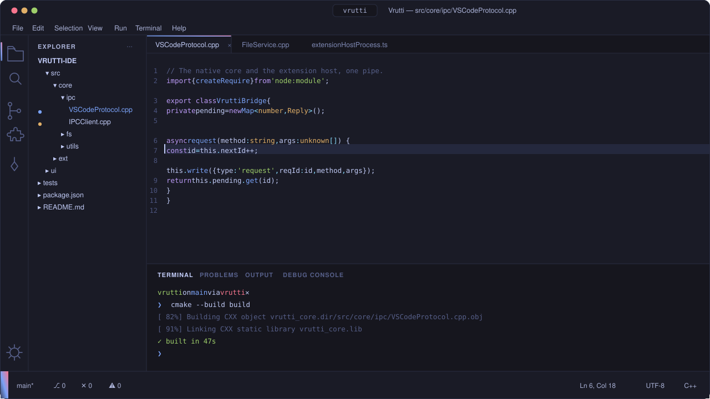
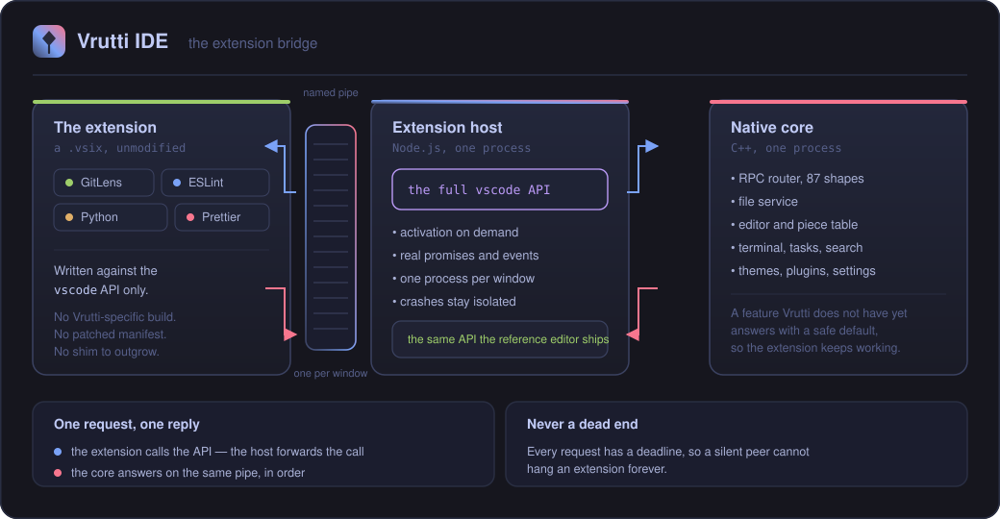
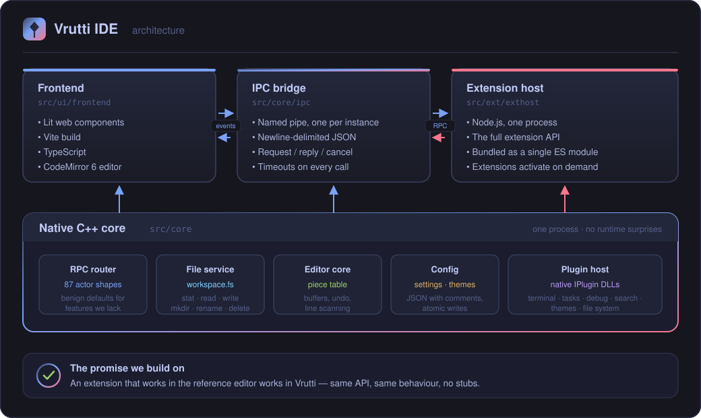

<div align="center">


# Vrutti IDE

### A native code editor that runs your extensions for real.


<br>

<a href="https://github.com/UnboundSB/Vrutti/releases/download/vrutti-early-release0.0.4/Vrutti_Alpha_0.0.4_SleepyRabbit_Setup.exe"></a>
&nbsp;&nbsp;
<a href="https://github.com/UnboundSB/Vrutti/releases"></a>
&nbsp;&nbsp;
<a href="https://github.com/UnboundSB/Vrutti/archive/refs/tags/vrutti-early-release0.0.4.tar.gz"></a>

</div>

<br>


<br>

**Vrutti is a code editor built the hard way, on purpose.** The core is native
C++, the interface is built from web components, and extensions run in a real
Node.js extension host against the real `vscode` API — not a shim, not a mock.

<div align="center">

| ⚡ Native core | 🧩 Real extensions | 🎨 Modern interface | 🪶 Light footprint |
|:---:|:---:|:---:|:---:|
| Buffers, files, terminals and search live in C++ | Your marketplace extensions load and activate unmodified | Lit web components, dark and pastel themes, a Git graph you can actually drag | One native process, one extension host, no Electron tax |

</div>

---

## ⬇️ Download

<div align="center">

| | 🪟 Windows installer | 📦 Source code | 📚 Older builds |
|---|:---:|:---:|:---:|
| **What** | `Vrutti_Alpha_0.0.4_SleepyRabbit_Setup.exe` | The full repository | Every tagged release |
| **Size** | 31.0 MB | — | — |
| **Format** | Inno Setup 6, LZMA2 | `.tar.gz` / `.zip` | `.exe` |
| **Needs admin** | Yes — installs to `Program Files` | No | — |
| **Get it** | [**Download →**](https://github.com/UnboundSB/Vrutti/releases/download/vrutti-early-release0.0.4/Vrutti_Alpha_0.0.4_SleepyRabbit_Setup.exe) | [**Download →**](https://github.com/UnboundSB/Vrutti/archive/refs/tags/vrutti-early-release0.0.4.tar.gz) | [**Releases →**](https://github.com/UnboundSB/Vrutti/releases) |

</div>

<sub>Pre-built and ready to run — no Docker, CMake, or compiler required.</sub>

### Verify what you downloaded

Every release ships a checksum. To confirm the file is the one we published:

```powershell
Get-FileHash .\Vrutti_Alpha_0.0.4_SleepyRabbit_Setup.exe -Algorithm SHA256
```

```
SHA256: a24a6f1234dc7aad26ed87eb77f7d4236f2f6d624770d64137f99d994df68ab9
```

### System requirements

| | |
|---|---|
| **Operating system** | Windows 10 or 11, 64-bit |
| **Memory** | 512 MB free |
| **Disk** | 200 MB for the installation |
| **Runtime** | None — the extension host runtime ships with the app |

---

## 📸 See it in action



The workbench is built from Lit web components — activity bar, explorer, tab
strip, editor groups, diff view, panel, quick pick, debug console, problems and
a status bar. The terminal is xterm.js, the editor is CodeMirror 6 with a
minimap, and the syntax highlighting understands C++, JavaScript, JSON and
Python out of the box.

---

## ✨ What is inside

<div align="center">

<table>
<tr>
<td width="50%" valign="top">

**🧩 An extension host that is not a shim**

Extensions load from a marketplace, activate on the event they declare, and
call the same API the reference editor ships. Vrutti listens on the calls the
host makes and answers them from native code.

</td>
<td width="50%" valign="top">

**⚙️ A native core that does the work**

File operations, the piece-table text model, terminals, search, settings and
themes are implemented in C++ behind a plugin interface. The UI is a thin
client of that core.

</td>
</tr>
<tr>
<td valign="top">

**🌳 A Git graph you can use**

A hardware-accelerated SVG canvas that draws branches and commits as a
topological graph, with drag-to-pan, interactive zoom, reflog parsing, and
direct actions on a commit — revert, rename, delete.

</td>
<td valign="top">

**🖥️ Terminal, tasks and debugging**

An embedded terminal with shell integration, a task runner driven by
`tasks.json`, a debug console and a debug adapter client that speaks the
Debug Adapter Protocol.

</td>
</tr>
<tr>
<td valign="top">

**🎨 Themes that extensions can ship**

A native theme service handles the built-in themes and the themes an
extension contributes through its manifest. Icon themes work the same way.

</td>
<td valign="top">

**🧭 A workbench that knows the shortcuts**

Find and replace, a problems panel, a diff editor, split editor groups, a
command palette, context menus, and a settings editor that writes valid
configuration every single time.

</td>
</tr>
</table>

</div>

---

## 🧩 Extension support



The rule Vrutti is built around:

> **If an extension works in the reference editor, it works in Vrutti.**

That means the `vscode` API is served by a real extension host process, not by
a compatibility layer that grows holes. The extension's own code is what runs.

### Where the project stands

The host speaks the full upstream protocol — **87 actor shapes, 516 methods**.
Vrutti answers the ones an ordinary extension touches and returns a safe
default for the ones it does not, so a missing feature never turns into a
broken extension.

| | |
|---|---|
| **Protocol shapes** | 87 |
| **Protocol methods** | 516 |
| **Methods answered** | 87 of 516 |
| **Audit** | `python scripts/audit_exthost_handlers.py` prints the live backlog |

The audit is part of the build, not a document that drifts. The same is true
of the fallback table: it is generated from the protocol signatures, so the
answer given to a missing feature always matches the type the caller expects.

Read more in **[docs/EXTENSION_COMPATIBILITY.md](docs/EXTENSION_COMPATIBILITY.md)**.

---

## 🏗️ Architecture



Three processes, one contract:

| Layer | Technology | Lives in | What it owns |
|---|---|---|---|
| **Frontend** | Lit, TypeScript, Vite | `src/ui/frontend` | The workbench: tabs, panels, views, the editor surface |
| **Bridge** | Named pipe, newline-delimited JSON | `src/core/ipc` | Requests, replies, cancellation, deadlines |
| **Extension host** | Node.js, ES module bundle | `src/ext/exthost` | The `vscode` API, extension activation, the extension processes |
| **Core** | C++20, CMake | `src/core` | Files, buffers, terminals, tasks, search, settings, themes, plugins |

The bridge is a private named pipe — one per window, never a TCP port, never
reachable from another machine. Every request has a deadline, so a silent
peer cannot hang an extension forever.

The core is built as native plugins behind an `IPlugin` interface, so a
feature can be added without touching the router.

---

## 🚀 Quick start

<table>
<tr><td width="8%" align="center"><b>1</b></td><td>Download the installer above</td></tr>
<tr><td align="center"><b>2</b></td><td>Run it — the installer offers to launch Vrutti when it finishes</td></tr>
<tr><td align="center"><b>3</b></td><td>Open a project folder; nothing needs configuring</td></tr>
<tr><td align="center"><b>4</b></td><td>Open the Extensions view and install the extensions you already use</td></tr>
</table>

<details>
<summary><b>Building from source</b> — only needed if you are changing Vrutti itself</summary>

<br>

**Requirements**

| Tool | Version | Why |
|---|---|---|
| CMake | 3.20+ | Builds the native core |
| A C++20 compiler | MinGW-w64 (ucrt64) | Builds the native core |
| Node.js | 20.11+ | Builds the frontend and the extension host bundle |
| [Inno Setup 6](https://jrsoftware.org/isdl.php) | 6.x | Packages the installer |

<sub>The native core is built and tested with MinGW-w64 (ucrt64). The CMake
configuration targets that toolchain.</sub>

**Steps**

```powershell
git clone https://github.com/UnboundSB/Vrutti.git
cd Vrutti
```

```powershell
# 1. The native core
cmake -S . -B build -DCMAKE_BUILD_TYPE=Release
cmake --build build
```

```powershell
# 2. The frontend
cd src/ui/frontend
npm install
npm run build
cd ../..
```

```powershell
# 3. The extension host bundle
npm install
npm run build:exthost
```

```powershell
# 4. A portable zip, then the installer
.\package_release.ps1     # vrutti_early_release.zip
.\build_installer.ps1     # Vrutti_Setup.exe
```

**Checks**

```powershell
ctest --test-dir build --output-on-failure     # the native test suites
python scripts/audit_exthost_handlers.py       # the extension host backlog
python scripts/generate_error_codes.py --check # the error code registry
python scripts/generate_exthost_fallbacks.py --check # the fallback table
python scripts/generate_structure_docs.py --check    # the generated folder docs
```

</details>

---

## 🗂️ Project layout

```
vrutti_ide/
├── src/
│   ├── core/          # the native C++ core
│   │   ├── ipc/       #   the bridge: protocol router, client, framing
│   │   ├── fs/        #   the file service behind workspace.fs
│   │   ├── editor/    #   the piece-table text model
│   │   ├── plugins/   #   the native plugin host
│   │   └── ...        #   terminal, configuration, themes, webview
│   ├── plugins/       # the lazily loaded search plugin
│   ├── ui/frontend/   # the Lit workbench
│   ├── ext/           # the extension host, the bridge, the built-in themes
│   └── tests/         # native and integration test suites
├── docs/              # architecture, compatibility and hardening notes
├── scripts/           # generators, audits and build helpers
├── installer/         # the Inno Setup script
└── errcode.md         # the error code registry
```

Every folder carries a `structure.md` that lists its files and public API, and
a `TODO.md` that lists what is still to be done there. Both are generated, so
they cannot go stale.

---

## 🗺️ Documentation

| | |
|---|---|
| **[architecture.md](architecture.md)** | How the pieces fit together |
| **[SYSTEM_ARCHITECTURE.md](SYSTEM_ARCHITECTURE.md)** | The system level view |
| **[docs/EXTENSION_COMPATIBILITY.md](docs/EXTENSION_COMPATIBILITY.md)** | The extension contract and the plan to satisfy it |
| **[docs/BACKEND_HARDENING.md](docs/BACKEND_HARDENING.md)** | The prioritized plan that makes the backend airtight |
| **[docs/component-model.md](docs/component-model.md)** | How native plugins are written and loaded |
| **[docs/HANDOFF.md](docs/HANDOFF.md)** | The handoff: the state of the work and the queue behind it |
| **[errcode.md](errcode.md)** | Every error code in the application, in one table |
| **[tasks.md](tasks.md)** | The release roadmap |

---

## 🤝 Contributing

<div align="center">

| Fork | Build | Submit | Get credited |
|:---:|:---:|:---:|:---:|
| [Fork the repo](https://github.com/UnboundSB/Vrutti/fork) | Build & test locally | [Open a PR](https://github.com/UnboundSB/Vrutti/pulls) | Added to the contributors list |

</div>

Found a bug? [Open an issue](https://github.com/UnboundSB/Vrutti/issues) — a
one-line report is more useful than no report, and contributions of any size
are welcome.

The backend comes first: a feature lands as a native plugin, then an IPC
method, then the frontend that uses it. The rationale is in
[docs/BACKEND_HARDENING.md](docs/BACKEND_HARDENING.md).

---

## 📄 License

Vrutti is released under the MIT License — see [LICENSE](LICENSE) for the full
terms.

The bundled third-party code keeps its own notices. They travel with every
release in `THIRD_PARTY_NOTICES.md`, and the full attribution list is in
[THIRD_PARTY_NOTICES.md](THIRD_PARTY_NOTICES.md).

---

<div align="center">
<sub>Built for developers who want a fast, modern editor without the setup overhead.</sub>
</div>
