# Vrutti IDE — VS Code Architecture (Full Breakdown)

**Source:** Parent `vrutti/` directory (upstream VS Code source).  
**Scope:** This document describes the **VS Code** architecture only — every component, subcomponent, and linking observed inside `vrutti/src/`. The `vrutti_ide/` directory is **not** modified by this document.

---

## Mermaid Component Diagram

```mermaid
graph TD
    %%======================================================================
    %% ENTRY & BOOTSTRAP  (src/)
    %%======================================================================
    subgraph Entry["Entry & Bootstrap — src/"]
        direction TB
        main_ts["src/main.ts<br/>Electron App Entry"]
        cli_ts["src/cli.ts<br/>CLI Entry"]
        b_meta["bootstrap-meta.ts<br/>product metadata"]
        b_node["bootstrap-node.ts<br/>portable config"]
        b_esm["bootstrap-esm.ts<br/>ESM loader"]
        b_cli["bootstrap-cli.ts"]
        b_fork["bootstrap-fork.ts"]
        b_import["bootstrap-import.ts"]
        b_server["bootstrap-server.ts"]
        s_cli["server-cli.ts"]
        s_main["server-main.ts"]
    end

    %%======================================================================
    %% ELECTRON SHELL
    %%======================================================================
    subgraph Electron["Electron Shell"]
        direction LR
        browser["Browser Process<br/>(Chromium main process)"]
        renderer["Renderer Process<br/>(WebContents / webview)"]
        utility["Utility Processes<br/>(sandboxed helpers)"]
        browser --> renderer
        browser --> utility
    end

    %%======================================================================
    %% WORKBENCH UI SHELL  (src/vr/workbench/)
    %%======================================================================
    subgraph Workbench["Workbench UI Shell — src/vr/workbench/"]
        direction TB
        wb_desktop["workbench.desktop.main.ts"]
        wb_common["workbench.common.main.ts"]
        wb_web["workbench.web.main.ts / web.main.internal.ts"]
        wb_zen["workbench.zenMode.contribution.ts"]

        subgraph Parts["Parts — browser/parts/"]
            direction LR
            actbar["ActivityBar"]
            sidebar["Sidebar"]
            panel["Panel"]
            edgrp["Editor<br/>(groups, tabs, editors)"]
            status["StatusBar"]
            title["TitleBar"]
            auxbar["AuxiliaryBar"]
            banner["Banner"]
            dlg["Dialogs"]
            notif["Notifications"]
            views["Views<br/>(view containers)"]
            compBar["CompositeBar"]
            paneComp["PaneCompositePart"]
            pcs["PaneCompositePartService"]
        end

        subgraph Common["Common — workbench/common/"]
            direction LR
            wcfg["Configuration"]
            wcontrib["Contributions"]
            wmemento["Memento"]
            wtheme["Theme"]
            wviews["Views"]
            wpane["PaneComposite"]
            wcomponent["Component"]
            wcomposite["Composite"]
        end

        subgraph API["Extension API — workbench/api/"]
            direction LR
            api_browser["Browser"]
            api_common["Common"]
            api_node["Node"]
            api_worker["Worker"]
        end

        subgraph Services["Services — workbench/services/"]
            direction LR
            wsvc_editor["Editor Service"]
            wsvc_theme["Theme Service"]
            wsvc_cmd["Command Service"]
            wsvc_key["Keybinding Service"]
            wsvc_cfg["Configuration Service"]
            wsvc_store["Storage Service"]
        end
    end

    %%======================================================================
    %% EDITOR ENGINE  (src/vr/editor/ Monaco)
    %%======================================================================
    subgraph Editor["Editor Engine — src/vr/editor/ (Monaco)"]
        direction TB
        ed_all["editor.all.ts"]
        ed_api["editor.api.ts"]
        ed_main["editor.main.ts"]
        ed_worker["editor.worker.start.ts"]

        subgraph EdBrowser["browser/"]
            direction LR
            ed_cfg["config/"]
            ed_ctrl["controller/"]
            ed_gpu["gpu/"]
            ed_svc["services/"]
            ed_view["view/"]
            ed_vp["viewParts/"]
            ed_wdgt["widget/"]
            ed_cmds["coreCommands.ts"]
            ed_obs["observableCodeEditor.ts"]
        end

        subgraph EdCommon["common/"]
        end
        subgraph EdContrib["contrib/"]
        end
        subgraph EdStandalone["standalone/"]
        end
    end

    %%======================================================================
    %% PLATFORM SERVICES  (src/vr/platform/ ~100 modules)
    %%======================================================================
    subgraph Platform["Platform Services — src/vr/platform/"]
        %% Core / DI / Lifecycle
        subgraph PfCore["Core / DI / Lifecycle"]
            direction LR
            inst["instantiation<br/>DI Container"]
            cmd["commands"]
            keyb["keybinding"]
            cfg["configuration"]
            ctxkey["contextkey"]
            life["lifecycle"]
            store["storage"]
            memo["memento"]
            ipc_plt["ipc"]
        end

        %% UI Services
        subgraph PfUI["UI Services"]
            direction LR
            theme["theme"]
            menubar["menubar"]
            qinput["quickinput"]
            dlg["dialogs"]
            notif_plt["notification"]
            prog["progress"]
            lst["list"]
            lbl["label"]
            hv["hover"]
            dnd["dnd"]
            domW["domWidget"]
            cssD["cssDev"]
            acc["accessibility"]
            accSig["accessibilitySignal"]
        end

        %% File / Workspace
        subgraph PfFile["File / Workspace"]
            direction LR
            files["files"]
            wspc["workspace"]
            wspcs["workspaces"]
            uri["uriIdentity"]
            backup["backup"]
            hist["history"]
            urd["undoRedo"]
        end

        %% Dev / Debug / Terminal / Extensions
        subgraph PfDev["Dev / Debug / Terminal / Extensions"]
            direction LR
            debug["debug"]
            term["terminal"]
            extTerm["externalTerminal"]
            extMgmt["extensionManagement"]
            extRec["extensionRecommendations"]
            extRes["extensionResourceLoader"]
            ext["extensions"]
            git["git"]
            diag["diagnostics"]
        end

        %% Network / Security / Remote
        subgraph PfNet["Network / Security / Remote"]
            direction LR
            netF["networkFilter"]
            opnr["opener"]
            url["url"]
            ep["endpoint"]
            dwn["download"]
            sbx["sandbox"]
            sec["secrets"]
            enc["encryption"]
            sgn["sign"]
            rem["remote"]
            remT["remoteTunnel"]
            tun["tunnel"]
            wce["webContentExtractor"]
        end

        %% System / Telemetry / Environment / Misc
        subgraph PfSys["System / Telemetry / Environment / Misc"]
            direction LR
            tel["telemetry"]
            prof["profiling"]
            otel["otel"]
            mc["meteredConnection"]
            env["environment"]
            udata["userData"]
            uprof["userDataProfile"]
            usync["userDataSync"]
            dacct["defaultAccount"]
            proc["process"]
            win["window"]
            wins["windows"]
            auxW["auxiliaryWindow"]
            lang["languagePacks"]
            cb["clipboard"]
            chksum["checksum"]
            dc["dataChannel"]
            lg["log"]
            md["markdown"]
            mdr["markdownRes"]
            mcp["mcp"]
            nat["native"]
            pol["policy"]
            proto["protocol"]
            reg["registry"]
            req["request"]
            st["state"]
            telProp["telemetryExperimentProperty"]
            upd["update"]
            ui_["userInteraction"]
            uproc["utilityProcess"]
            wv["webview"]
            ww["webWorker"]
            kvs["jsonschemas"]
            kl["keyboardLayout"]
            launch["launch"]
            layout["layout"]
            lt["localTranscription"]
            obs["observable"]
            ir["imageResize"]
            ctview["contextview"]
        end
    end

    %%======================================================================
    %% OTHER MODULES
    %%======================================================================
    subgraph Other["Other Modules"]
        direction LR
        sessions["sessions/<br/>(browser, common, contrib, services, skills)"]
        code_mod["code/<br/>(browser, electron-browser, electron-main, electron-utility, node)"]
        srv_mod["server/<br/>(node)"]
        base_mod["base/<br/>(browser, common, node, parts)"]
        typ["typings/"]
        dts["vscode-dts/<br/>API contract<br/>(179 proposed .d.ts files)"]
    end

    %%======================================================================
    %% EXTENSION HOST (separate Node process)
    %%======================================================================
    subgraph ExtHost["Extension Host — separate Node.js process"]
        direction TB
        exhost["extensionHostProcess.js"]
        exapi["vscode API surface<br/>(shimmed from vscode-dts)"]
        exlsp["LSP Client<br/>(lsp-client.js)"]
        exdap["DAP Client<br/>(dap-client.js)"]
        extm["TextMate Engine<br/>(textmate-engine.js)"]
        exthm["Theme Resolver<br/>(theme-resolver.js)"]
    end

    %%======================================================================
    %% LINKING — ENTRY -> SHELL
    %%======================================================================
    main_ts --> b_meta
    main_ts --> b_node
    main_ts --> b_esm
    main_ts --> wb_desktop
    cli_ts --> b_cli
    cli_ts --> b_fork
    cli_ts --> b_import
    cli_ts --> b_server
    cli_ts --> s_cli
    cli_ts --> s_main

    wb_desktop --> Parts
    wb_desktop --> Common
    wb_desktop --> Services
    wb_desktop --> API
    wb_desktop --> Editor
    wb_common --> Parts
    wb_web --> Parts
    wb_zen --> title

    %%======================================================================
    %% LINKING — WORKBENCH PARTS <-> PLATFORM CORE
    %%======================================================================
    actbar --> inst
    sidebar --> inst
    panel --> inst
    edgrp --> inst
    status --> inst
    title --> inst
    auxbar --> inst
    banner --> inst
    dlg --> inst
    notif --> inst
    views --> inst

    wcfg --> cfg
    wcontrib --> inst
    wmemento --> memo
    wtheme --> theme
    wviews --> views
    wpane --> paneComp
    wcomponent --> inst
    wcomposite --> compBar

    wsvc_editor --> ed_main
    wsvc_theme --> theme
    wsvc_cmd --> cmd
    wsvc_key --> keyb
    wsvc_cfg --> cfg
    wsvc_store --> store

    %%======================================================================
    %% LINKING — EDITOR -> PLATFORM
    %%======================================================================
    ed_main --> inst
    ed_main --> cfg
    ed_main --> cmd
    ed_worker --> exhost
    ed_gpu --> renderer
    ed_view --> edgrp
    ed_ctrl --> keyb
    ed_svc --> store

    %%======================================================================
    %% LINKING — PLATFORM CORE INTERCONNECT
    %%======================================================================
    inst --> cmd
    inst --> keyb
    inst --> cfg
    inst --> ctxkey
    inst --> life
    inst --> store
    inst --> memo
    inst --> ipc_plt

    cmd --> keyb
    cmd --> life
    cfg --> store
    cfg --> memo
    keyb --> life
    theme --> wtheme
    notif_plt --> notif
    dlg --> dlg
    qinput --> sidebar
    prog --> panel
    term --> extTerm
    debug --> exdap
    ext --> exhost
    extMgmt --> exhost
    git --> wspc
    files --> wspc
    uri --> files
    rem --> remT
    remT --> tun
    sbx --> uproc
    sec --> enc
    enc --> sgn
    udata --> usync
    uprof --> usync
    dacct --> env
    proc --> wins
    win --> wins
    auxW --> wins
    lang --> dts
    wv --> renderer
    ww --> exhost

    %%======================================================================
    %% LINKING — EXTENSION HOST
    %%======================================================================
    exhost --> exapi
    exhost --> exlsp
    exhost --> exdap
    exhost --> extm
    exhost --> exthm
    exapi -.->|JSON-RPC<br/>MainThreadShape / ExtHostShape| wb_desktop
    exapi -.->|JSON-RPC| inst
    dts -.->|defines API contract| exapi
    dts -.->|defines API contract| ext

    %%======================================================================
    %% LINKING — OTHER MODULES
    %%======================================================================
    wb_desktop --> sessions
    wb_desktop --> code_mod
    wb_desktop --> srv_mod
    wb_desktop --> base_mod
    inst --> typ

    %%======================================================================
    %% STYLING
    %%======================================================================
    classDef entry fill:#e1f5fe,stroke:#01579b,stroke-width:2px;
    classDef workbench fill:#f3e5f5,stroke:#4a148c,stroke-width:2px;
    classDef editor fill:#e8f5e9,stroke:#1b5e20,stroke-width:2px;
    classDef platform fill:#fff3e0,stroke:#e65100,stroke-width:2px;
    classDef exthost fill:#ffebee,stroke:#b71c1c,stroke-width:2px;
    classDef other fill:#f5f5f5,stroke:#424242,stroke-width:2px;

    class main_ts,cli_ts,b_meta,b_node,b_esm entry;
    class wb_desktop,wb_common,wb_web,actbar,sidebar,panel,edgrp,status,title workbench;
    class ed_all,ed_api,ed_main,ed_worker,EdBrowser editor;
    class inst,cmd,keyb,cfg,theme,files,wspc,debug,term,ext platform;
    class exhost,exapi,exlsp,exdap,extm,exthm exthost;
    class sessions,code_mod,srv_mod,base_mod,typ,dts other;
```

---

## Linking Summary (Data & Control Flows)

| Flow | From | To | Mechanism |
|------|------|----|-----------|
| App bootstrap | `src/main.ts` | `bootstrap-meta.ts`, `bootstrap-node.ts`, `bootstrap-esm.ts` | Direct TS import |
| App launch | `src/main.ts` | `workbench.desktop.main.ts` | Electron `app.on('ready')` → `startup()` |
| Window/shell | `workbench.desktop.main.ts` | Workbench Parts (ActivityBar, Sidebar, Panel, Editor, StatusBar, TitleBar, ...) | Workbench contribution registration |
| DI wiring | Parts / Common | `instantiation` (DI Container) | `createDecorator` / `ServiceCollection` |
| Editor | `workbench.desktop.main.ts` | Monaco `editor.main.ts` | Workbench → Editor service |
| Editor webworker | `editor.worker.start.ts` | Extension Host | Language features run in separate worker |
| Platform core | `instantiation` | commands, keybinding, configuration, contextkey, lifecycle, storage, memento, ipc | DI instantiation on demand |
| Extensions | `extensionManagement` / `extensions` | Extension Host (`extensionHostProcess.js`) | Spawned Node process |
| ExtHost ↔ Workbench | Extension Host | Workbench / Platform Core | JSON-RPC over IPC (`MainThreadShape` / `ExtHostShape`) |
| API contract | `vscode-dts/` (179 `.d.ts` files) | Extension Host API surface | TypeScript declaration contract |
| Rendering | Platform `webview`, `webWorker` | Electron Renderer / Utility processes | Chromium IPC |

---

## Component Inventory by Directory

**Entry (`src/`)**  
`main.ts`, `cli.ts`, `bootstrap-cli.ts`, `bootstrap-esm.ts`, `bootstrap-fork.ts`, `bootstrap-import.ts`, `bootstrap-meta.ts`, `bootstrap-node.ts`, `bootstrap-server.ts`, `server-cli.ts`, `server-main.ts`

**Workbench (`src/vr/workbench/`)**  
`workbench.common.main.ts`, `workbench.desktop.main.ts`, `workbench.web.main.ts`, `workbench.web.main.internal.ts`, `workbench.zenMode.contribution.ts`, `workbench.contribution.ts`  
Parts: `activitybar`, `auxiliarybar`, `banner`, `dialogs`, `editor`, `media`, `notifications`, `panel`, `sidebar`, `statusbar`, `titlebar`, `views`, `compositeBar.ts`, `compositeBarActions.ts`, `compositePart.ts`, `globalCompositeBar.ts`, `paneCompositeBar.ts`, `paneCompositePart.ts`, `paneCompositePartService.ts`, `visibleViewContainersTracker.ts`  
Common: `activity.ts`, `comments.ts`, `component.ts`, `composite.ts`, `configuration.ts`, `contextkeys.ts`, `contributions.ts`, `dialogs.ts`, `editor.ts`, `memento.ts`, `notifications.ts`, `panecomposite.ts`, `resources.ts`, `theme.ts`, `views.ts`  
API: `browser/`, `common/`, `node/`, `test/`, `worker/`  
Services: `services/`

**Editor (`src/vr/editor/` — Monaco)**  
`editor.all.ts`, `editor.api.ts`, `editor.main.ts`, `editor.worker.start.ts`  
Browser internals: `config/`, `controller/`, `gpu/`, `services/`, `view/`, `viewParts/`, `widget/`, `coreCommands.ts`, `dataTransfer.ts`, `editorBrowser.ts`, `editorDom.ts`, `editorExtensions.ts`, `observableCodeEditor.ts`, `stableEditorScroll.ts`, `triggerInlineEditCommandsRegistry.ts`, `view.ts`  
Plus `common/`, `contrib/`, `standalone/`, `test/`

**Platform (`src/vr/platform/` — ~100 modules)**  
`accessibility`, `accessibilitySignal`, `action`, `actions`, `actionWidget`, `agentHost`, `agentPlugins`, `assignment`, `auxiliaryWindow`, `backup`, `browserView`, `checksum`, `clipboard`, `commands`, `configuration`, `contextkey`, `contextview`, `cssDev`, `dataChannel`, `debug`, `defaultAccount`, `diagnostics`, `dialogs`, `dnd`, `domWidget`, `download`, `editor`, `encryption`, `endpoint`, `environment`, `extensionManagement`, `extensionRecommendations`, `extensionResourceLoader`, `extensions`, `externalServices`, `externalTerminal`, `files`, `git`, `globalKeybindings`, `history`, `hover`, `imageResize`, `instantiation`, `ipc`, `jsonschemas`, `keybinding`, `keyboardLayout`, `label`, `languagePacks`, `launch`, `layout`, `lifecycle`, `list`, `localTranscription`, `log`, `markdown`, `markdownRes`, `mcp`, `menubar`, `meteredConnection`, `native`, `networkFilter`, `notification`, `observable`, `opener`, `otel`, `policy`, `process`, `product`, `profiling`, `progress`, `protocol`, `quickinput`, `registry`, `remote`, `remoteTunnel`, `request`, `sandbox`, `secrets`, `sign`, `state`, `storage`, `telemetry`, `terminal`, `test`, `theme`, `tunnel`, `undoRedo`, `update`, `uriIdentity`, `url`, `userData`, `userDataProfile`, `userDataSync`, `userInteraction`, `utilityProcess`, `webContentExtractor`, `webview`, `webWorker`, `window`, `windows`, `workspace`, `workspaces`

**Other modules**  
`sessions/` (browser, common, contrib, electron-browser, services, skills), `code/` (browser, electron-browser, electron-main, electron-utility, node), `server/` (node), `base/` (browser, common, node, parts), `typings/`, `vscode-dts/` (179 proposed `.d.ts` files)

**Extension Host (separate Node process)**  
`extensionHostProcess.js` plus LSP client, DAP client, TextMate engine, and Theme Resolver.

---

*This document is a read-only architectural analysis of the parent `vrutti/` VS Code source. No files inside `vrutti/` were modified.*